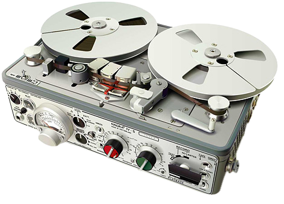
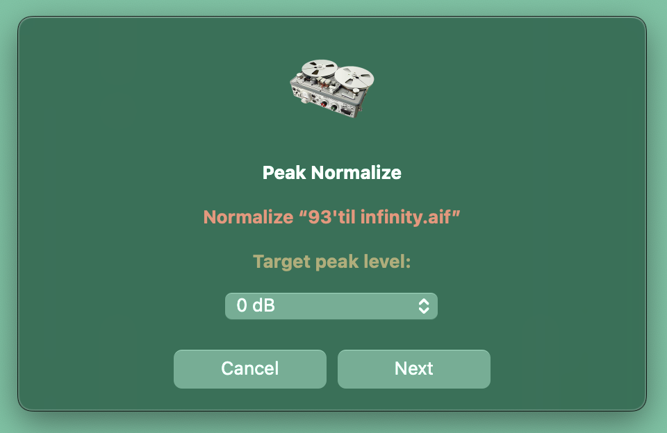

<p align="center">
  
</p>

# Audio Quick Actions

A small collection of macOS Finder Quick Actions for music producers and sound designers. Select your audio files in the Finder, right-click, pick a Quick Action — that's it.

| Quick Action | What it does |
|---|---|
| [Peak Normalize](#peak-normalize) | Peak-normalizes lossless audio files without losing their metadata (Apple Loops tags included). |

More Quick Actions are coming (Loudness Normalize is next).

---

## Peak Normalize

Normalizes the peak level of your audio files to the level you choose, while keeping everything else exactly as it was.



### Features

- **Choose your target level**: 0 dB, -0.1 dB, -0.2 dB, -0.5 dB or -1 dB
- **Overwrite or Duplicate**: replace the original files, or create normalized copies in a `Normalized` subfolder next to the originals (same file names)
- **Metadata stays intact**: for WAV, AIFF and CAF files, only the audio samples are rewritten. Apple Loops information (tempo, key, tags, transients), markers, ID3 tags, Finder tags and Spotlight comments are all preserved
- **Same format, same resolution**: a 16-bit / 44.1 kHz WAV stays a 16-bit / 44.1 kHz WAV. Bit depth (8, 16, 24, 32-bit integer or float) and sample rate never change
- **Lossless formats only**: WAV, AIFF / AIF / AIFC, CAF (uncompressed) and FLAC. Lossy files (MP3, AAC/M4A…) are skipped and listed at the end
- **Smart**: files already at the requested level are not processed again
- **Fast**: several files are processed in parallel

### Requirements

- macOS (tested on macOS 14 Sonoma, Apple Silicon and Intel)
- [Homebrew](https://brew.sh), then in Terminal:

  ```bash
  brew install sox_ng ffmpeg
  ```

  `sox_ng` processes WAV, AIFF and CAF files (the classic `sox` formula works too). `ffmpeg` is only needed for FLAC files.

### Download & installation

1. Download `Peak-Normalize.zip` from the **[Releases](https://github.com/Creme74/Audio-Quick-Actions/releases/latest)** page and unzip it.
2. Double-click `Peak Normalize.workflow` and click **Install**.
3. If it doesn't show up in the Finder's right-click menu, open **System Settings**, search for **Extensions**, go to **Finder** and tick **Peak Normalize**.

### Usage

1. Select one or more audio files in the Finder.
2. Right-click → **Quick Actions** → **Peak Normalize**.
3. Choose the target peak level and click **Next**.
4. Choose **Overwrite** (replace the originals) or **Duplicate** (copies in a `Normalized` subfolder).

A notification tells you when it's done. If some files were skipped or could not be processed, a window lists them with the reason.

### Good to know

- **16-bit files** get a light TPDF dither when the gain is applied, which is the standard way to avoid quantization distortion.
- **Already normalized files**: if a file's peak is within 0.01 dB of the target, its audio is left untouched, but its modification date is updated like the others. In Duplicate mode it is still copied, so the `Normalized` folder is always complete.
- **Overwrite cannot be undone.** Use Duplicate if you want to keep your originals.

### Customization

The settings are at the top of the script (open the workflow in Automator to edit it):

```zsh
levels=(0 -0.1 -0.2 -0.5 -1)   # target peak levels offered, in dBFS
default_level=0
tolerance=0.01                 # dB: files this close to the target are left as is
copydir="Normalized"           # subfolder used by "Duplicate"
```

[`Peak Normalize/peak-normalize.sh`](Peak%20Normalize/peak-normalize.sh) is a readable copy of the script embedded in the workflow.

### Uninstall

Delete `Peak Normalize.workflow` from `~/Library/Services`.

---

## License

This project is distributed under the **GPL-3.0-or-later** license — see [LICENSE](LICENSE).

## Author

Made by **Nicolas Scaravilli** (Kid Creme)

- [Bandcamp](https://kidcreme.bandcamp.com/)
- [Spotify](https://open.spotify.com/artist/21LRoheW1z49N5d52wlQ5X)
