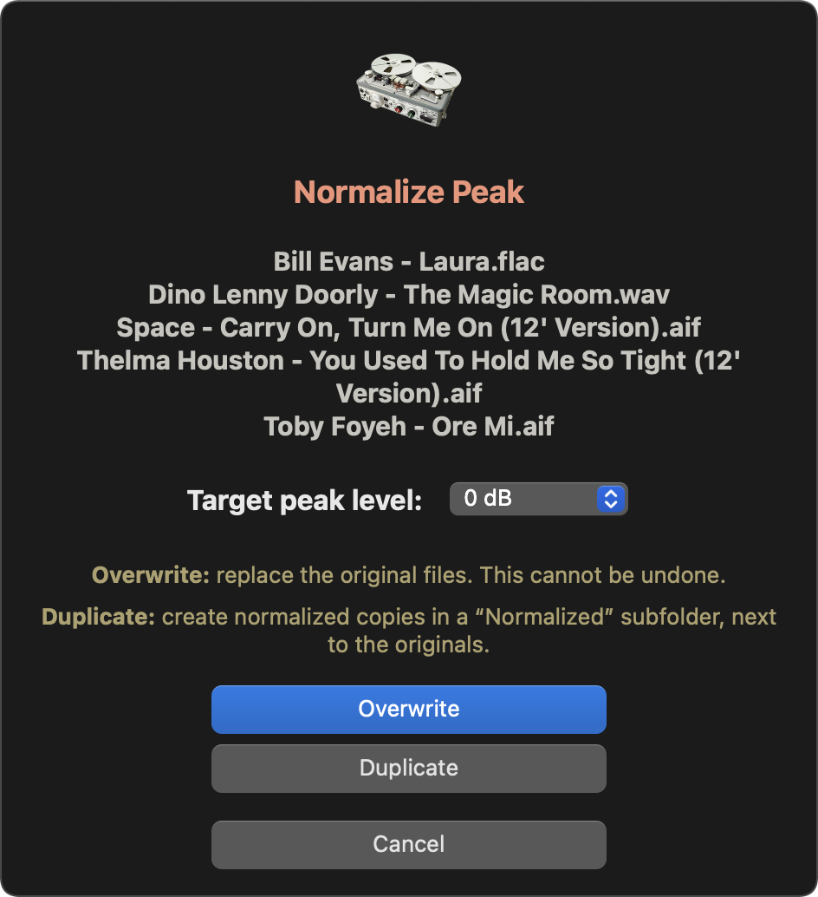
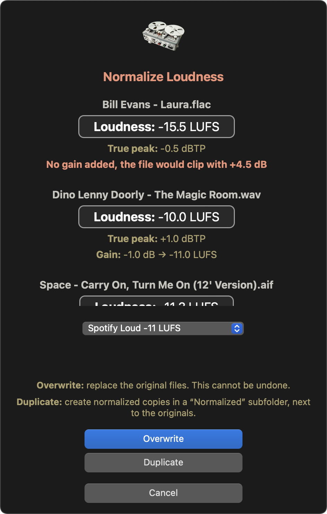
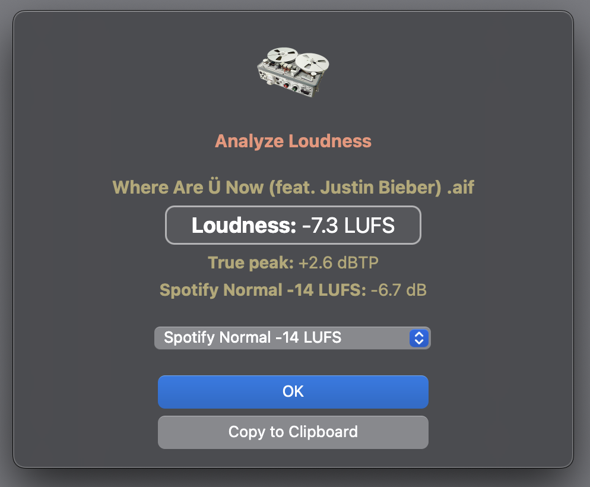
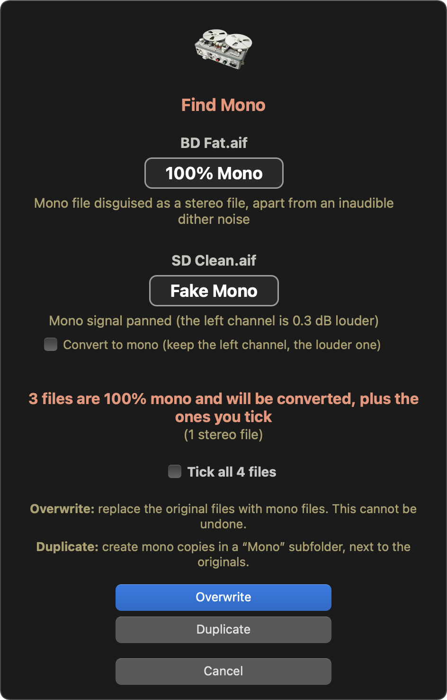
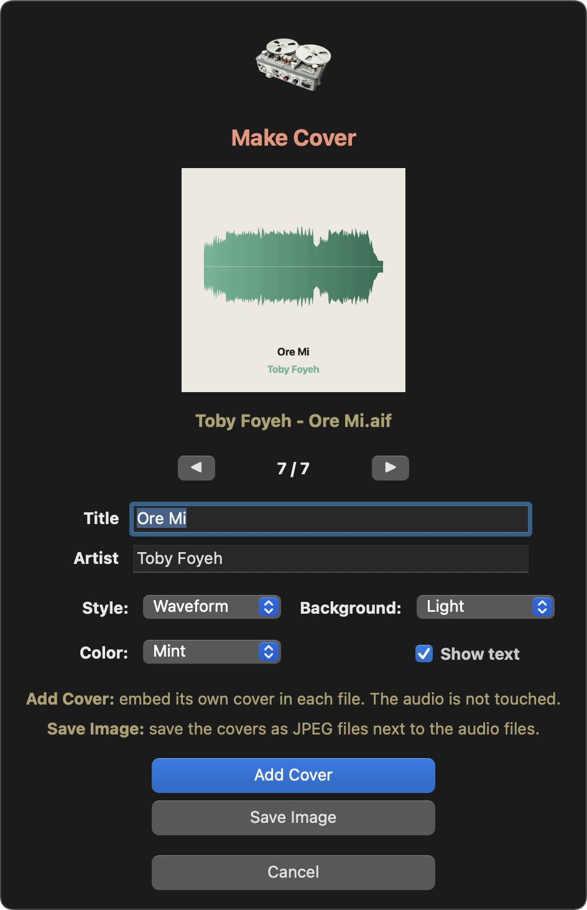
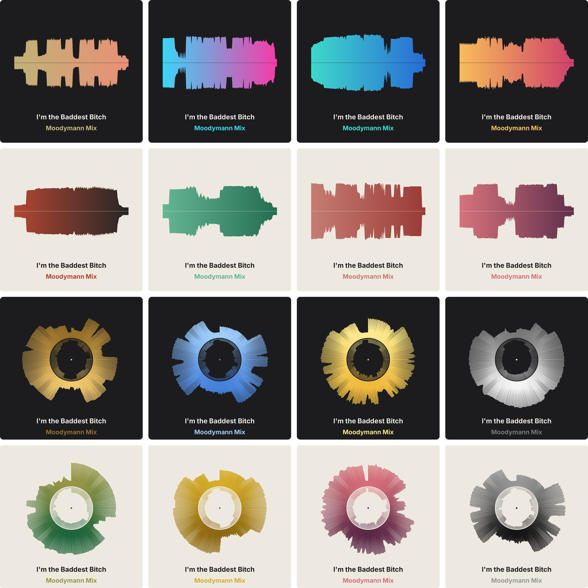

<p align="center">
  
</p>

# Audio Quick Actions

A small collection of macOS Finder Quick Actions for music producers and sound designers. Select your audio files in the Finder, right-click, pick a Quick Action — that's it.

| Quick Action | What it does |
|---|---|
| [Normalize Peak](#normalize-peak) | Peak-normalizes lossless audio files without losing their metadata (Apple Loops tags included). |
| [Normalize Loudness](#normalize-loudness) | Brings lossless audio files to a target loudness (Spotify, Apple Music, YouTube, broadcast or your own value), with a plain, transparent gain change. |
| [Analyze Loudness](#analyze-loudness) | Measures the loudness (LUFS) and true peak of any audio file, and shows what each streaming platform would do with it. |
| [Find Mono](#find-mono) | Finds mono audio hidden in stereo files and turns those files into real mono files, bit for bit. |
| [Make Cover](#make-cover) | Draws a cover from the waveform of each track and embeds it in the file, without touching the audio. |

---

## Requirements

- macOS (tested on macOS 14 Sonoma, Apple Silicon and Intel)
- [Homebrew](https://brew.sh), then in Terminal:

  ```bash
  brew install sox_ng ffmpeg
  ```

| | `sox_ng` | `ffmpeg` |
|---|---|---|
| Normalize Peak | WAV, AIFF, CAF | FLAC only |
| Normalize Loudness | WAV, AIFF, CAF | always (measurement and FLAC) |
| Analyze Loudness | — | always |
| Find Mono | — | always |
| Make Cover | — | always |

The classic `sox` formula works too.

**First run:** the first time a Quick Action works on files in your Downloads, Desktop or Documents folder, or on an external drive, macOS may ask whether *ffmpeg*, *ffprobe* or *sox* can access them. Click **Allow** for each one. If you clicked *Don't Allow*, go to **System Settings › Privacy & Security › Files and Folders**, find the tool and turn the folder or **Removable Volumes** back on. macOS may ask again after a Homebrew update.

## Download & installation

1. Download the Quick Action you want from the **[Releases](https://github.com/Creme74/Audio-Quick-Actions/releases/latest)** page and unzip it:
   - [Normalize-Peak.zip](https://github.com/Creme74/Audio-Quick-Actions/releases/latest/download/Normalize-Peak.zip)
   - [Normalize-Loudness.zip](https://github.com/Creme74/Audio-Quick-Actions/releases/latest/download/Normalize-Loudness.zip)
   - [Analyze-Loudness.zip](https://github.com/Creme74/Audio-Quick-Actions/releases/latest/download/Analyze-Loudness.zip)
   - [Find-Mono.zip](https://github.com/Creme74/Audio-Quick-Actions/releases/latest/download/Find-Mono.zip)
   - [Make-Cover.zip](https://github.com/Creme74/Audio-Quick-Actions/releases/latest/download/Make-Cover.zip)
2. Double-click the `.workflow` file and click **Install**.
3. If it doesn't show up in the Finder's right-click menu, open **System Settings**, search for **Extensions**, go to **Finder** and tick it.

To use it: select one or more audio files in the Finder, then right-click → **Quick Actions** → the Quick Action.

---

## Normalize Peak

Normalizes the peak level of your audio files to the level you choose, while keeping everything else exactly as it was.

<p align="center">
  
</p>

### Features

- **Choose your target level**: 0 dB, -0.1 dB, -0.2 dB, -0.5 dB or -1 dB
- **Overwrite or Duplicate**: replace the original files, or create normalized copies in a `Normalized` subfolder next to the originals (same file names)
- **Metadata stays intact**: for WAV, AIFF and CAF files, only the audio samples are rewritten. Apple Loops information (tempo, key, tags, transients), markers, ID3 tags, Finder tags and Spotlight comments are all preserved
- **Same format, same resolution**: a 16-bit / 44.1 kHz WAV stays a 16-bit / 44.1 kHz WAV. Bit depth (8, 16, 24, 32-bit integer or float) and sample rate never change
- **Lossless formats only**: WAV, AIFF / AIF / AIFC, CAF (uncompressed) and FLAC. Lossy files (MP3, AAC/M4A…) are skipped and listed at the end
- **Smart**: files already at the requested level are not processed again
- **Fast**: several files are processed in parallel

### Good to know

- **16-bit files** get a light TPDF dither when the gain is applied, which is the standard way to avoid quantization distortion.
- **Already normalized files**: if a file's peak is within 0.01 dB of the target, its audio is left untouched, but its modification date is updated like the others. In Duplicate mode it is still copied, so the `Normalized` folder is always complete.
- **Overwrite cannot be undone.** Use Duplicate if you want to keep your originals.

### Customization

The settings are at the top of the script (open the workflow in Automator to edit it):

```zsh
levels=(0 -0.1 -0.2 -0.5 -1)   # target peak levels offered, in dBFS
default_level=0
tolerance=0.01                 # dB: files this close to the target are left as is
copydir="Normalized"           # subfolder used by "Duplicate"
```

[`Normalize Peak/normalize-peak.sh`](Normalize%20Peak/normalize-peak.sh) is a readable copy of the script embedded in the workflow.

---

## Normalize Loudness

Measures the loudness of your audio files, shows the gain each one needs for the target you choose, then applies it — and nothing else.

<p align="center">
  
</p>

### Features

- **Measured like the streaming platforms**: integrated loudness (LUFS) and true peak (dBTP), with the ITU-R BS.1770 / EBU R128 method
- **Choose your target** in the menu: Spotify Normal -14, Spotify Loud -11, Spotify Quiet -19, YouTube -14, Apple Music -16, Tidal -14, Amazon Music -14, Deezer -15, SoundCloud -14, Broadcast EBU R128 -23 LUFS
- **Custom target**: pick **Custom…** at the bottom of the menu and type your own value (from -60 to 0 LUFS); the gains are updated as you type
- **See before you apply**: the gain and the resulting loudness are shown for every file, for the selected target
- **As transparent as possible**: a plain gain change — no compressor, no limiter, no EQ
- **Overwrite or Duplicate**, **metadata stays intact**, **same format, same resolution**, **lossless formats only**: exactly like Normalize Peak. Other files (MP3, AAC/M4A…) are measured and shown, but never modified

### Good to know

- **Quiet files with loud peaks**: loud files are always turned down to the target, but quiet files are only turned up until their true peak reaches -1 dBTP, so nothing clips. Such files may end up below the target; the window says *limited by true peak*. Reaching the target anyway would need a limiter, which would no longer be transparent.
- **Files already at the target** (0.0 dB gain): their audio is left untouched, only their modification date is updated (copied as is in Duplicate mode).
- **16-bit files** get a light TPDF dither when the gain is applied.
- **Overwrite cannot be undone.** Use Duplicate if you want to keep your originals.

### Customization

```zsh
targets=(                      # "Name:LUFS", the first one is selected by default
  "Spotify Normal:-14"
  ...
)
ceiling=-1                     # dBTP: quiet files are never turned up past this true peak
copydir="Normalized"           # subfolder used by "Duplicate"
```

[`Normalize Loudness/normalize-loudness.sh`](Normalize%20Loudness/normalize-loudness.sh) is a readable copy of the script embedded in the workflow.

---

## Analyze Loudness

Measures the loudness of your audio files and shows what each streaming platform would do with them. Nothing is modified.

<p align="center">
  
</p>

### Features

- **Any audio format** ffmpeg can read: WAV, AIFF, CAF, FLAC, ALAC, MP3, AAC/M4A…
- **Integrated loudness** (LUFS) and **true peak** (dBTP), with the ITU-R BS.1770 / EBU R128 method
- **Platform menu**: the gain Spotify (Normal, Loud, Quiet), YouTube, Apple Music, Tidal, Amazon Music, Deezer, SoundCloud or a broadcast EBU R128 delivery would apply to each file, track by track, with notes such as *not turned up*, *limited by true peak* or *limiter*
- **Several files at once**: the results are listed under each file name, and one menu switches the platform for all of them
- **Copy to Clipboard**: file name, loudness, true peak and the result for the selected platform

### Good to know

Spotify's targets and rules come from its official documentation. The other platforms' values are the ones commonly reported; they are not always officially published and may change.

[`Analyze Loudness/analyze-loudness.sh`](Analyze%20Loudness/analyze-loudness.sh) is a readable copy of the script embedded in the workflow.

---

## Find Mono

Sample packs and old projects are full of stereo files that are really mono: twice the size, for nothing. Find Mono finds them and can turn them into real mono files, without changing a single sample of the audio.

<p align="center">
  
</p>

### What it finds

| Result | Meaning | Converted |
|---|---|---|
| **100% Mono** | Mono file disguised as a stereo file: both channels are identical (or differ only by an inaudible dither noise) | Yes |
| **99.9% Mono** | Practically mono: the difference between the channels is at least 40 dB below the signal | If you tick its box |
| **Fake Mono** | A mono signal panned to one side, or with one channel in inverted polarity | If you tick its box |
| **Left / Right channel only** | One channel is silent | If you tick its box |
| **Real stereo** | A real stereo file | No |

### Features

- **Batch friendly**: select a hundred files; when several files are selected, only the ones with something to do are listed, with the number of stereo and mono files found. If there is nothing to do: *All good, no hidden mono file found!*
- **Overwrite or Duplicate**: replace the original files, or create mono copies in a `Mono` subfolder next to the originals (same file names)
- **Nothing is recomputed**: the mono file keeps one channel exactly as it was, bit for bit (the left one, or the louder one for a panned file). Every converted file is compared sample by sample with the original before it is kept
- **Metadata stays intact**: for WAV, AIFF and CAF files, every chunk is kept byte for byte (Apple Loops information, markers, ID3 tags, sampler data…), except the ones that describe the channels. Finder tags and Spotlight comments are kept too
- **Same format, same resolution**: bit depth and sample rate never change; FLAC files stay FLAC, with their tags and cover art
- **Lossless formats only**: WAV, AIFF / AIF / AIFC, CAF (uncompressed) and FLAC. Other files are skipped

### Good to know

- The analysis is done in double precision on the whole file: the level of each channel, of their sum and of their difference.
- **Overwrite cannot be undone.** Use Duplicate if you want to keep your originals.

[`Find Mono/find-mono.sh`](Find%20Mono/find-mono.sh) is a readable copy of the script embedded in the workflow.

---

## Make Cover

Gives every track its own cover, drawn from its own sound: the loudness of the whole track over time, as a waveform or a circle. Handy for demos, promos, edits and bounces that would otherwise show up as a blank square in your music player or DJ software.

<p align="center">
  
</p>

<p align="center">
  
</p>

### Features

- **Two styles**: *Waveform* (a mirrored waveform across the cover) or *Circle* (the waveform wrapped around a circle)
- **Dark or Light background**, and **13 color gradients**: Vintage, Red Ink, Faded Red, Gold, Mono, Neon, Sunset, Ocean, Sky, Forest, Mint, Blush, Yellow. Each color has its own shades for each background: 52 different looks, and the shape is always the track's own
- **Title and artist**: suggested from the file's tags, or from its name (`Artist - Title`), and editable. Untick **Show text** for a cover without text
- **Live preview**: the cover is redrawn as you change the style, the colors or the text
- **Several files at once**: each file gets its own cover; use ◀ ▶ to go through them and adjust each title and artist
- **Add Cover**: the cover is embedded in the file and replaces the existing one, if any. The audio is never touched: every file is checked against the original before it is replaced
- **Save Image**: saves the cover next to the audio file instead, as `<file name> - Cover.jpg`
- **3000 × 3000 px JPEG**, the size most distributors ask for
- **Formats**: AIFF / AIF / AIFC, WAV, FLAC, MP3 and M4A (AAC and ALAC)

### Good to know

- **AIFF and WAV**: the cover goes in the file's ID3 tag. Every other chunk and every other tag (Apple Loops information, markers…) is kept byte for byte.
- **FLAC, MP3 and M4A**: the file is rewritten by ffmpeg without re-encoding (stream copy), with its tags.
- **Where covers show up**: AIFF, MP3 and M4A covers appear in the Finder, Music and most DJ software. WAV and FLAC covers are read by DJ software and many players, but the Finder doesn't show them (a macOS limitation).

[`Make Cover/make-cover.sh`](Make%20Cover/make-cover.sh) is a readable copy of the script embedded in the workflow.

---

## Uninstall

Delete the `.workflow` file from `~/Library/Services`.

## License

This project is distributed under the **GPL-3.0-or-later** license — see [LICENSE](LICENSE).

## Author

Made by **Nicolas Scaravilli** (Kid Creme)

- [Bandcamp](https://kidcreme.bandcamp.com/)
- [Spotify](https://open.spotify.com/artist/21LRoheW1z49N5d52wlQ5X)
